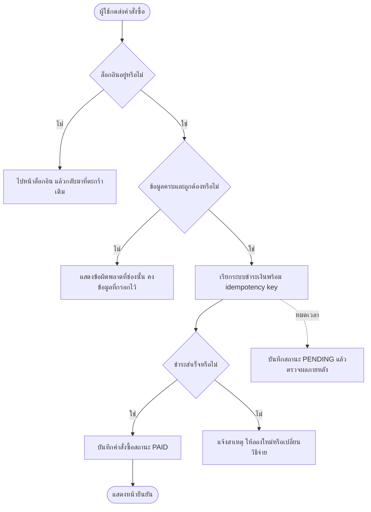
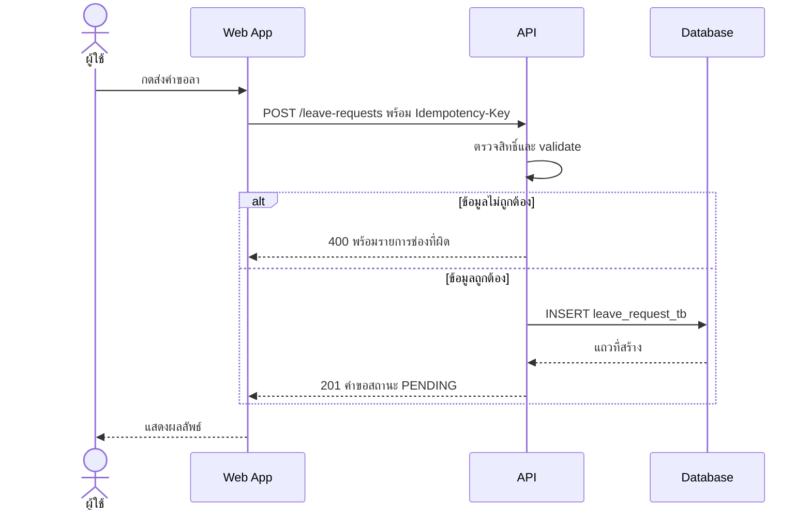
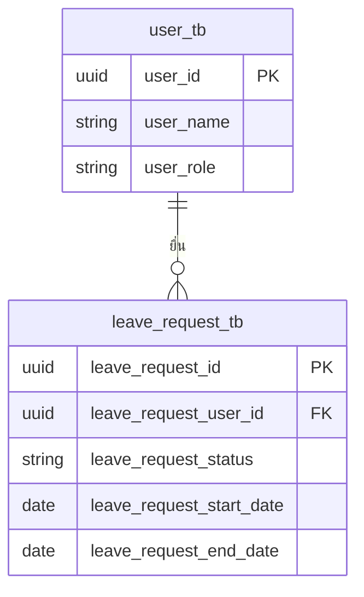
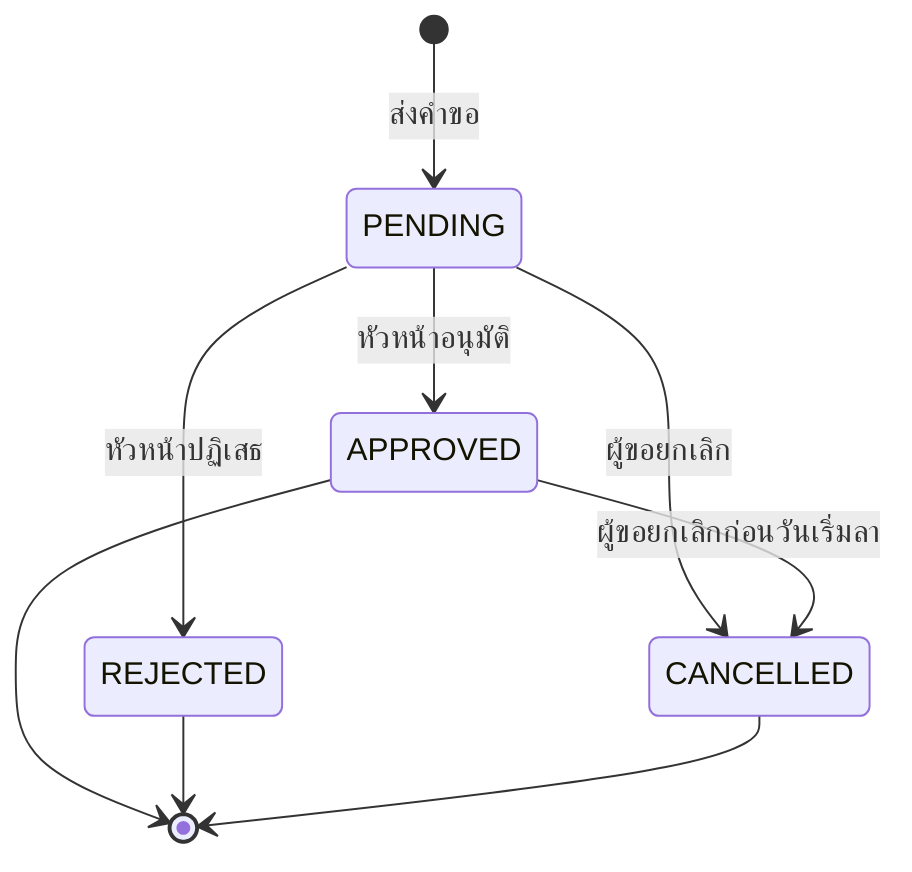

# ออกแบบ flow และกระบวนการทำงานของระบบ

ใช้เมื่อต้องออกแบบหรืออธิบายว่า ผู้ใช้เดินผ่านระบบอย่างไร งานไหลผ่านคนและระบบอย่างไร หรือส่วนประกอบคุยกันอย่างไร สำหรับการวางแผนฟีเจอร์ก่อนเขียนโค้ดให้ใช้คู่กับ [project-flow.md](project-flow.md)

## เลือกชนิดแผนภาพให้ตรงคำถาม

| คำถามที่ต้องตอบ                         | ชนิด                        | Mermaid                           |
| --------------------------------------- | --------------------------- | --------------------------------- |
| ผู้ใช้ทำอะไรทีละขั้น ตัดสินใจตรงไหน     | User flow                   | `flowchart`                       |
| งานส่งต่อระหว่างคน/แผนก/ระบบอย่างไร     | Business process (swimlane) | `flowchart` + `subgraph` ต่อ lane |
| สิ่งหนึ่งมีสถานะอะไรบ้าง เปลี่ยนเมื่อไร | State machine               | `stateDiagram-v2`                 |
| ส่วนประกอบเรียกกันลำดับไหน              | Sequence                    | `sequenceDiagram`                 |
| ข้อมูลเกิดที่ไหน ไปเก็บที่ไหน           | Data flow / ER              | `flowchart` / `erDiagram`         |
| ระบบมีกล่องอะไร เชื่อมกันอย่างไร        | Architecture                | `flowchart`                       |

แผนภาพหนึ่งรูปตอบคำถามเดียว ถ้ารูปเดียวต้องเล่าทั้งขั้นตอนผู้ใช้ สถานะ และการเรียก API จะอ่านไม่ออก ให้แยกรูป

ถ้าเครื่องมือของ session มีตัวสร้างแผนภาพ (เช่น FigJam, whiteboard) และเจ้าของต้องการรูปที่แก้ร่วมกันได้ ให้ใช้เครื่องมือนั้น ไม่เช่นนั้นใช้ Mermaid ในไฟล์ markdown เพราะเก็บใน repo และ diff ได้

## ขั้นตอนออกแบบ

1. **ระบุขอบเขต:** flow เริ่มจากเหตุการณ์อะไร (trigger) จบเมื่อได้ผลลัพธ์อะไร ใครเกี่ยวข้อง (actor) และอะไรอยู่นอกขอบเขต
2. **เขียนเส้นทางหลักเป็นข้อความก่อน:** 5–9 ขั้น ประโยคละหนึ่งการกระทำ รูปแบบ "ใคร ทำอะไร กับอะไร" ถ้าเกิน 9 ขั้นให้แบ่งเป็น flow ย่อย
3. **หาจุดตัดสินใจ:** ทุกจุดที่ผลออกได้มากกว่าหนึ่งทาง เขียนเงื่อนไขให้ตรวจได้จริง ("ยอด > วงเงินอนุมัติ" ไม่ใช่ "ถ้าเหมาะสม")
4. **เติมเส้นทางที่ไม่สำเร็จ:** ไล่แต่ละขั้นด้วยรายการในหัวข้อ "เส้นทางที่ต้องมี" ด้านล่าง
5. **ผูกกับข้อมูลและสถานะ:** แต่ละขั้นอ่าน/เขียนข้อมูลอะไร สถานะเปลี่ยนจากอะไรเป็นอะไร ถ้ามีสถานะเกินสามค่าให้ทำ state machine แยก
6. **วาดแผนภาพ** จากข้อความที่ตรวจแล้ว
7. **ไล่ตรวจด้วยตัวอย่างจริง:** เลือกกรณีปกติหนึ่งและกรณีผิดพลาดสองกรณี เดินตามรูปทีละกล่อง ถ้าเดินแล้วไปต่อไม่ได้หรือไม่รู้ว่าใครทำ แปลว่าแบบยังไม่ครบ

## เส้นทางที่ต้องมี

flow ที่มีแต่เส้นทางสำเร็จคือแบบที่ยังทำไม่เสร็จ เพราะงานส่วนใหญ่ของระบบจริงอยู่ที่เส้นทางเหล่านี้:

- ข้อมูลไม่ผ่านการตรวจ: แจ้งอะไร ให้แก้ตรงไหน ข้อมูลที่กรอกแล้วหายหรือไม่
- ไม่มีสิทธิ์ หรือ session หมดอายุกลางทาง
- ไม่พบข้อมูล หรือข้อมูลถูกคนอื่นเปลี่ยนไปแล้ว
- ระบบภายนอกล้มเหลวหรือช้า: retry กี่ครั้ง รอเท่าไร แล้วทำอะไรต่อ
- ส่งซ้ำหรือกดซ้ำ: ผลต้องเท่ากับทำครั้งเดียว
- ยกเลิกกลางทาง: ข้อมูลที่ทำไปแล้วครึ่งหนึ่งอยู่ในสภาพไหน
- สำเร็จบางส่วน: อะไร rollback ได้ อะไรต้องชดเชย (compensate) เช่น คืนเงิน ส่งแจ้งเตือนแก้ไข
- สำหรับอุปกรณ์หรือ IoT: ออฟไลน์, ไฟดับกลางการทำงาน, ข้อมูลมาถึงช้าหรือซ้ำ, นาฬิกาไม่ตรง

## Business process

แต่ละขั้นของกระบวนการให้ระบุครบหกช่อง ช่องที่ว่างคือคำถามที่ต้องถามเจ้าของ:

| ขั้น | ผู้รับผิดชอบ | การกระทำ | ระบบ/เครื่องมือ | ข้อมูลเข้า → ออก | เงื่อนไขเสร็จ | ข้อยกเว้น |
| ---- | ------------ | -------- | --------------- | ---------------- | ------------- | --------- |

ตรวจเพิ่ม: จุดส่งต่องานระหว่างคนมีการแจ้งเตือนหรือไม่ มีขั้นไหนที่งานค้างได้โดยไม่มีใครรู้ ขั้นอนุมัติมีทางออกเมื่อผู้อนุมัติไม่อยู่หรือไม่ และขั้นไหนที่ระบบทำแทนคนได้

## State machine

เขียนตารางก่อนวาดรูป เพราะตารางบังคับให้คิดครบทุกช่อง:

| สถานะปัจจุบัน | เหตุการณ์ | เงื่อนไข | สถานะถัดไป | ผลข้างเคียง |
| ------------- | --------- | -------- | ---------- | ----------- |

กฎตรวจ: ทุกสถานะที่ไม่ใช่สถานะสุดท้ายต้องมีทางออก ไม่มีสถานะที่เข้าไม่ถึง เหตุการณ์ที่มาผิดสถานะต้องมีพฤติกรรมกำหนดไว้ (ปฏิเสธหรือเพิกเฉย) และชื่อสถานะเก็บเป็น constant/enum ตาม [coding-standards.md](coding-standards.md) ข้อ 7

## รูปแบบ Mermaid

- กล่องขั้นตอนขึ้นต้นด้วยกริยา ("ตรวจสิทธิ์", "บันทึกคำสั่งซื้อ") จุดตัดสินใจเป็นคำถามที่ตอบใช่/ไม่ใช่ และทุกเส้นออกจากจุดตัดสินใจมีป้ายกำกับ
- ทิศทางเดียวทั้งรูป (`TD` หรือ `LR`) เส้นทางหลักเป็นแนวตรง เส้นทางผิดพลาดแยกออกด้านข้าง
- ไม่เกินราว 15 กล่องต่อรูป เกินให้แยกเป็น flow ย่อยแล้วอ้างชื่อ
- id ของ node เป็นอังกฤษสั้น ๆ ข้อความในกล่องใส่เครื่องหมายคำพูดเมื่อมีวงเล็บหรืออักขระพิเศษ เพื่อไม่ให้ render พัง

## สิ่งที่ส่งมอบ

1. สรุปหนึ่งย่อหน้า: flow นี้คืออะไร เริ่มและจบที่ไหน
2. แผนภาพ
3. ตารางขั้นตอนหรือตารางสถานะ
4. รายการเส้นทางผิดพลาดและวิธีรับมือ
5. การตัดสินใจออกแบบที่สำคัญพร้อมเหตุผล และทางเลือกที่ไม่ได้ใช้
6. สมมติฐานและคำถามค้าง

ถ้าขั้นต่อไปคือเขียนโค้ด ให้ต่อด้วย contract ของข้อมูลตาม [project-flow.md](project-flow.md) หัวข้อ 4 และถ้ามีหน้าจอ ให้จับคู่แต่ละขั้นของ flow กับหน้าจอและสถานะใน [ux-ui.md](ux-ui.md)

## คำถามที่ต้องมีคำตอบก่อนออกแบบ

หาคำตอบจากโปรเจ็กต์และคำสั่งก่อน ข้อที่หาไม่ได้และมีผลต่อแบบให้ถามเจ้าของรวมครั้งเดียว ข้อที่ไม่กระทบโครงให้ตั้งสมมติฐานแล้วระบุไว้

1. ใครเริ่ม flow นี้ และด้วยเหตุการณ์อะไร
2. flow จบเมื่อไร ผลลัพธ์สุดท้ายคืออะไร ใครได้รับแจ้ง
3. มีผู้เกี่ยวข้องกี่บทบาท แต่ละบทบาททำอะไรได้
4. ข้อมูลอะไรถูกสร้างหรือเปลี่ยน เก็บที่ไหน
5. มีระบบภายนอกอะไรเกี่ยวข้อง ถ้าล่มแล้วธุรกิจยอมรับผลอะไรได้
6. มีขั้นไหนต้องรอคน รอนานสุดเท่าไร เกินแล้วทำอย่างไร
7. ยกเลิกหรือแก้ไขย้อนหลังได้ถึงขั้นไหน
8. ปริมาณโดยประมาณ: กี่รายการต่อวัน พร้อมกันสูงสุดเท่าไร
9. มีกฎหรือข้อบังคับ เช่น ต้องเก็บประวัติว่าใครทำอะไรเมื่อไร หรือไม่

## แม่แบบ sequence และ ER

ลูกศรทึบ `->>` คือการเรียก ลูกศรประ `-->>` คือการตอบกลับ ใช้ `alt/else` สำหรับทางแยก และ `opt` สำหรับขั้นที่ทำเมื่อเข้าเงื่อนไข

ชื่อตารางและคอลัมน์ทำตาม naming convention ใน [coding-standards.md](coding-standards.md) `||--o{` อ่านว่า หนึ่งต่อศูนย์หรือหลาย

## ตัวอย่างครบชุด: ระบบขอลาหยุด

ใช้เป็นแบบของความละเอียดที่ต้องการ งานจริงให้ทำครบทุกส่วนแบบเดียวกัน

**1. ขอบเขต** เริ่มเมื่อพนักงานกดสร้างคำขอลา จบเมื่อคำขอถูกอนุมัติ ปฏิเสธ หรือยกเลิก และพนักงานได้รับแจ้ง ผู้เกี่ยวข้อง: พนักงาน, หัวหน้า, ระบบแจ้งเตือน นอกขอบเขต: การคำนวณเงินเดือน

**2. เส้นทางหลัก**

1. พนักงานกรอกวันลาและเหตุผล แล้วกดส่ง
2. ระบบตรวจข้อมูลและวันลาคงเหลือ
3. ระบบบันทึกคำขอสถานะ PENDING
4. ระบบแจ้งหัวหน้า
5. หัวหน้าเปิดคำขอและกดอนุมัติ
6. ระบบเปลี่ยนสถานะเป็น APPROVED และหักวันลาคงเหลือ
7. ระบบแจ้งพนักงาน

**3. จุดตัดสินใจ** วันลาคงเหลือ ≥ จำนวนวันที่ขอหรือไม่ / ช่วงวันที่ซ้อนกับคำขอที่ยังมีผลอยู่หรือไม่ / หัวหน้าอนุมัติหรือปฏิเสธ

**4. เส้นทางที่ไม่สำเร็จ**

| สถานการณ์                                  | พฤติกรรมของระบบ                                                                                         |
| ------------------------------------------ | ------------------------------------------------------------------------------------------------------- |
| วันสิ้นสุดก่อนวันเริ่ม                     | แสดงข้อผิดพลาดที่ช่องวันที่ ไม่ส่งคำขอ                                                                  |
| วันลาไม่พอ                                 | แจ้งจำนวนวันคงเหลือ ไม่สร้างคำขอ                                                                        |
| กดส่งซ้ำ                                   | ใช้ idempotency key คืนคำขอเดิม ไม่สร้างซ้ำ                                                             |
| แจ้งเตือนหัวหน้าไม่สำเร็จ                  | คำขอยังถูกบันทึก ระบบส่งแจ้งเตือนใหม่ภายหลัง หัวหน้ายังเห็นคำขอในรายการรออนุมัติ                        |
| หัวหน้าไม่ตอบภายใน 3 วันทำการ              | แจ้งเตือนซ้ำ และส่งต่อผู้อนุมัติสำรอง (ต้องถามเจ้าของว่าใคร)                                            |
| หัวหน้ากดอนุมัติพร้อมกับที่พนักงานกดยกเลิก | เปลี่ยนสถานะด้วยเงื่อนไขสถานะเดิม = PENDING ตัวที่มาถึงก่อนสำเร็จ อีกตัวได้รับแจ้งว่าสถานะเปลี่ยนไปแล้ว |
| อนุมัติแล้วแต่หักวันลาไม่สำเร็จ            | สองอย่างอยู่ใน transaction เดียวกัน ล้มเหลวทั้งคู่และคงสถานะ PENDING                                    |
| คนที่ไม่ใช่หัวหน้าของพนักงานพยายามอนุมัติ  | ปฏิเสธ ไม่เปิดเผยรายละเอียดคำขอ                                                                         |

**5. ตารางสถานะ**

| สถานะปัจจุบัน                 | เหตุการณ์      | เงื่อนไข                       | สถานะถัดไป | ผลข้างเคียง              |
| ----------------------------- | -------------- | ------------------------------ | ---------- | ------------------------ |
| (ไม่มี)                       | พนักงานส่งคำขอ | ข้อมูลถูกต้อง วันลาพอ ไม่ซ้อน  | PENDING    | แจ้งหัวหน้า              |
| PENDING                       | หัวหน้าอนุมัติ | เป็นหัวหน้าของผู้ขอ            | APPROVED   | หักวันลา แจ้งพนักงาน     |
| PENDING                       | หัวหน้าปฏิเสธ  | เป็นหัวหน้าของผู้ขอ ระบุเหตุผล | REJECTED   | แจ้งพนักงาน              |
| PENDING                       | ผู้ขอยกเลิก    | เป็นเจ้าของคำขอ                | CANCELLED  | แจ้งหัวหน้า              |
| APPROVED                      | ผู้ขอยกเลิก    | ยังไม่ถึงวันเริ่มลา            | CANCELLED  | คืนวันลา แจ้งหัวหน้า     |
| APPROVED, REJECTED, CANCELLED | เหตุการณ์อื่น  | —                              | คงเดิม     | ตอบว่าทำไม่ได้ในสถานะนี้ |

**6. การตัดสินใจและเหตุผล** หักวันลาตอนอนุมัติ ไม่ใช่ตอนส่งคำขอ เพราะคำขอที่ถูกปฏิเสธจะไม่ต้องคืนวัน ข้อเสียคือพนักงานอาจส่งคำขอหลายใบเกินวันคงเหลือ จึงตรวจวันคงเหลืออีกครั้งตอนอนุมัติ ทางเลือกที่ไม่ใช้: จองวันลาตอนส่งคำขอ เพราะต้องมีกลไกคืนวันในทุกเส้นทางที่ไม่สำเร็จ

**7. สมมติฐานและคำถามค้าง** สมมติว่าพนักงานหนึ่งคนมีหัวหน้าหนึ่งคน คำถาม: ผู้อนุมัติสำรองคือใคร ลาครึ่งวันได้หรือไม่ วันหยุดนักขัตฤกษ์นับเป็นวันลาหรือไม่

## ข้อผิดพลาดของ Mermaid ที่พบบ่อย

ตรวจทุกข้อก่อนส่ง แผนภาพที่ render ไม่ขึ้นไม่มีประโยชน์กับเจ้าของ

- ข้อความที่มีวงเล็บ เครื่องหมาย `:` `/` `#` หรือเครื่องหมายคำพูด ต้องครอบด้วย `"..."` เช่น `a["ตรวจ (รอบ 2)"]`
- id ของ node ใช้ตัวอักษรอังกฤษและตัวเลข ไม่มีช่องว่าง และห้ามใช้คำว่า `end` เป็น id
- ป้ายบนเส้นเขียน `-- ข้อความ -->` หรือ `-->|ข้อความ|` เลือกแบบเดียวทั้งรูป
- `subgraph` ต้องปิดด้วย `end` ทุกอัน
- บรรทัดแรกต้องเป็นชนิดแผนภาพ (`flowchart TD`, `sequenceDiagram`, `stateDiagram-v2`, `erDiagram`)
- ใน `stateDiagram-v2` ชื่อสถานะไม่มีช่องว่าง ใช้ `[*]` สำหรับจุดเริ่มและจุดจบ
- ทุก node ที่ประกาศต้องมีเส้นเชื่อม ไม่มี node ลอย
- รัน `node <skill>/scripts/check-mermaid.mjs <ไฟล์.md>` ทุกครั้ง สคริปต์จับข้อผิดพลาดในรายการนี้ รวมถึงจุดตัดสินใจที่ไม่มีป้ายและสถานะที่ไม่มีทางออก
- ถ้ามีเครื่องมือ render ใน session ให้ render ดูจริงด้วย
