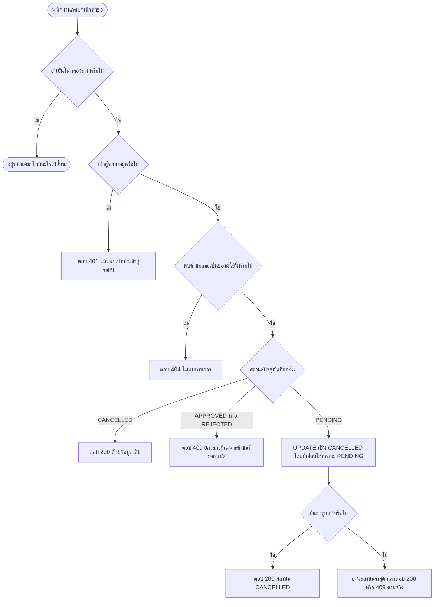

# ตัวอย่างงานครบวงจร: ยกเลิกคำขอลา

ตัวอย่างหนึ่งฟีเจอร์ตั้งแต่รับคำขอจนถึงรายงานส่งมอบ ใช้เป็นแบบของลำดับงานและระดับความละเอียด โค้ดในไฟล์นี้ผ่าน `tsc` แบบ strict และ test 12 ข้อด้วย Zod 4 และ Vitest ก่อนนำมาใส่ ชื่อไฟล์ ตาราง และข้อความเป็นของตัวอย่าง งานจริงให้ใช้ของโปรเจ็กต์

ลำดับที่ใช้: โจทย์ → สำรวจ → ทางเลือก → กรณีพัง → flow → contract → หน้าจอ → โค้ด → test → ตรวจ → วิจารณ์ → รายงาน

## สารบัญ

1. คำขอและแบบสรุปโจทย์
2. สำรวจของเดิม
3. ทางเลือกและการตัดสินใจ
4. กรณีพัง
5. Flow และสถานะ
6. Contract ของ API
7. หน้าจอ
8. โค้ด
9. Test
10. ผลตรวจ
11. วิจารณ์ตัวเอง
12. รายงานส่งมอบ

## 1. คำขอและแบบสรุปโจทย์

คำขอจากเจ้าของ: "ให้พนักงานยกเลิกคำขอลาของตัวเองได้"

```text
เป้าหมาย: พนักงาน ต้องการ ยกเลิกคำขอลาที่ส่งไปแล้ว เพื่อ ไม่ต้องติดต่อหัวหน้าหรือฝ่ายบุคคลให้ยกเลิกแทน
เสร็จเมื่อ:
  1. เจ้าของคำขอกดยกเลิกคำขอสถานะ PENDING แล้วสถานะเป็น CANCELLED
  2. กดยกเลิกซ้ำได้ผลเดิม ไม่เกิดข้อผิดพลาด
  3. ยกเลิกคำขอของคนอื่นไม่ได้ และไม่รู้ว่าคำขอนั้นมีอยู่
  4. คำขอที่อนุมัติหรือปฏิเสธแล้ว ยกเลิกไม่ได้ พร้อมข้อความบอกเหตุผล
ในขอบเขต: API ยกเลิก, ปุ่มในหน้ารายละเอียดคำขอ
นอกขอบเขต: ยกเลิกคำขอที่อนุมัติแล้วและการคืนวันลา, การแจ้งเตือนหัวหน้า
ข้อเท็จจริง: มีตาราง leave_request_tb และสถานะสี่ค่า, มี error class กลาง
สมมติฐาน: ตัวตนผู้ใช้มาจาก middleware เดิมเป็น user id
คำถามค้าง: ต้องแจ้งหัวหน้าเมื่อคำขอถูกยกเลิกหรือไม่
ขนาดงาน: กลาง เพราะเป็นฟีเจอร์เดียว แต่แก้ข้อมูลและมีเรื่องสิทธิ์
```

## 2. สำรวจของเดิม

ทำตาม [coding-playbooks.md](coding-playbooks.md) หัวข้อ A แล้วจดสิ่งที่ต้อง reuse:

- `shared/errors/app-error.ts` มี `AppError`, `NotFoundError`, `ConflictError`, `ValidationError`, `UnauthorizedError` และ `toErrorResponse`
- ฟีเจอร์อื่นจัดไฟล์เป็น `*.constants.ts`, `*.schema.ts`, `*.repository.ts`, `*.service.ts`, `*.handler.ts`
- คำสั่งตรวจ: `npx tsc -p .` และ `npx vitest run`
- ยังไม่มีระบบแจ้งเตือน และยังไม่มีตารางวันลาคงเหลือ ข้อนี้ทำให้ตัดการยกเลิกคำขอที่อนุมัติแล้วออกจากขอบเขต

## 3. ทางเลือกและการตัดสินใจ

```text
การตัดสินใจ: คำขอสถานะไหนยกเลิกได้
| เกณฑ์            | A: เฉพาะ PENDING      | B: PENDING และ APPROVED         |
| ตอบโจทย์ครบไหม   | ครบสำหรับกรณีหลัก      | ครบทุกกรณี                      |
| ความซับซ้อน      | UPDATE เดียว           | ต้องคืนวันลาใน transaction       |
| กระทบของเดิม     | ไม่มี                  | ต้องมีตารางวันลาคงเหลือซึ่งยังไม่มี |
| ความเสี่ยงถ้าผิด  | ต่ำ                    | วันลาคงเหลือผิดพลาด              |
เลือก: A เพราะทำได้ด้วยของที่มีและไม่แตะยอดวันลา
ข้อเสียที่ยอมรับ: คำขอที่อนุมัติแล้วยังต้องให้หัวหน้าจัดการ แจ้งเจ้าของไว้ในรายงาน
```

การตัดสินใจที่สอง: เปลี่ยนสถานะด้วย `UPDATE ... WHERE status = 'PENDING'` แทนการอ่านแล้วเขียนทับ เพราะหัวหน้าอาจอนุมัติในเสี้ยววินาทีเดียวกัน และฐานข้อมูลเป็นจุดเดียวที่ตัดสินได้ว่าใครมาก่อน

## 4. กรณีพัง

| สถานการณ์ | ควรเกิดอะไร | จัดการอย่างไร |
| --- | --- | --- |
| รหัสคำขอไม่ใช่ uuid | 400 พร้อมรายละเอียด | validate params ด้วย schema |
| ยังไม่เข้าสู่ระบบ | 401 | ตรวจ `userId` ก่อนทำอย่างอื่น |
| คำขอไม่มีอยู่ | 404 | `findById` คืน null |
| คำขอของคนอื่น | 404 ข้อความเดียวกับไม่มีอยู่ | กฎ `NOT_OWNER` แปลงเป็น `NotFoundError` |
| กดยกเลิกสองครั้ง | ครั้งที่สองได้ 200 ผลเดิม | กฎ `ALREADY_CANCELLED` คืนข้อมูลปัจจุบัน |
| คำขออนุมัติหรือปฏิเสธแล้ว | 409 พร้อมเหตุผล | กฎ `NOT_PENDING` |
| หัวหน้าอนุมัติระหว่างอ่านกับเขียน | 409 สถานะเปลี่ยนไปแล้ว | UPDATE มีเงื่อนไขสถานะ ไม่มีแถวถูกแก้ แล้วอ่านใหม่ |
| ฐานข้อมูลคืนแถวผิดรูปแบบ | 500 และมี log | `LeaveRequestSchema.parse` ใน repository |

## 5. Flow และสถานะ



การเปลี่ยนสถานะที่เพิ่มในงานนี้มีเส้นเดียว: `PENDING --> CANCELLED` เมื่อเจ้าของคำขอยกเลิก สถานะอื่นไม่เปลี่ยน

## 6. Contract ของ API

`POST /leave-requests/{leave_request_id}/cancel` ไม่มี body ใช้ POST เพราะเป็นการสั่งให้เกิดการกระทำ ไม่ใช่การแก้ฟิลด์ทั่วไป และเรียกซ้ำได้ผลเดิม

| ผลลัพธ์ | status | body |
| --- | --- | --- |
| ยกเลิกสำเร็จ หรือยกเลิกไปแล้ว | 200 | `leave_request_id`, `leave_request_status`, `leave_request_start_date`, `leave_request_end_date`, `leave_request_reason` |
| รหัสไม่ถูกต้อง | 400 | `code: VALIDATION_ERROR`, `message`, `trace_id`, `details` |
| ยังไม่เข้าสู่ระบบ | 401 | `code: UNAUTHORIZED`, `message`, `trace_id` |
| ไม่พบ หรือไม่ใช่เจ้าของ | 404 | `code: NOT_FOUND`, `message`, `trace_id` |
| สถานะไม่อนุญาต หรือเพิ่งเปลี่ยน | 409 | `code: CONFLICT`, `message`, `trace_id` |

response ไม่มี `leave_request_user_id` เพราะหน้าจอไม่ได้ใช้ และไม่ควรส่งข้อมูลเกินจำเป็น

## 7. หน้าจอ

แก้หน้า "รายละเอียดคำขอลา" ที่มีอยู่ ไม่สร้างหน้าใหม่

| หัวข้อ | รายละเอียด |
| --- | --- |
| สิ่งที่เพิ่ม | ปุ่มรอง "ยกเลิกคำขอ" แบบเส้นขอบสีแดง ใต้ข้อมูลคำขอ |
| แสดงเมื่อ | สถานะเป็น PENDING เท่านั้น สถานะอื่นไม่แสดงปุ่ม |
| กล่องยืนยัน | หัวข้อ: "ยกเลิกคำขอลา 01/12/2569 – 03/12/2569 หรือไม่" เนื้อหา: "หัวหน้าจะไม่เห็นคำขอนี้ในรายการรออนุมัติอีก หากต้องการลาต้องส่งคำขอใหม่" ปุ่ม: "ยกเลิกคำขอ" (แดง) และ "ไม่ยกเลิก" (ค่าเริ่มต้น) |

| สถานะ | สิ่งที่แสดง |
| --- | --- |
| กำลังส่ง | ปุ่มในกล่องยืนยันแสดงตัวหมุน กดซ้ำไม่ได้ |
| สำเร็จ (200) | ปิดกล่อง ป้ายสถานะเปลี่ยนเป็น "ยกเลิกแล้ว" ปุ่มยกเลิกหายไป toast "ยกเลิกคำขอลาแล้ว" |
| สถานะเปลี่ยนไปแล้ว (409) | ปิดกล่อง โหลดข้อมูลใหม่ แสดงข้อความค้างเหนือข้อมูล "คำขอนี้ได้รับการพิจารณาแล้ว จึงยกเลิกไม่ได้" |
| ไม่พบ (404) | แสดงหน้า "ไม่พบคำขอลา" พร้อมลิงก์กลับรายการ |
| เครือข่ายล้มเหลว | กล่องยืนยันยังเปิดอยู่ แสดง "ยกเลิกไม่สำเร็จ ตรวจการเชื่อมต่อแล้วลองใหม่" |
| session หมดอายุ (401) | พาไปหน้าเข้าสู่ระบบ แล้วกลับมาหน้ารายละเอียดเดิม |

ไม่ใช้ชื่อปุ่ม "ยกเลิก" ในกล่องยืนยัน เพราะจะกำกวมว่ายกเลิกคำขอหรือยกเลิกการกระทำ

## 8. โค้ด

เขียนตามลำดับ constant → schema → กฎ → repository → service → handler แต่ละไฟล์ typecheck ผ่านก่อนไปไฟล์ถัดไป

```ts
// features/leave/leave.constants.ts
export const TABLE = {
  LEAVE_REQUEST: "leave_request_tb",
} as const;

export const LEAVE_STATUS = {
  PENDING: "PENDING",
  APPROVED: "APPROVED",
  REJECTED: "REJECTED",
  CANCELLED: "CANCELLED",
} as const;

export const LEAVE_STATUS_VALUES = [
  LEAVE_STATUS.PENDING,
  LEAVE_STATUS.APPROVED,
  LEAVE_STATUS.REJECTED,
  LEAVE_STATUS.CANCELLED,
] as const;

export const CANCEL_DENIED_REASON = {
  NOT_OWNER: "NOT_OWNER",
  ALREADY_CANCELLED: "ALREADY_CANCELLED",
  NOT_PENDING: "NOT_PENDING",
} as const;

export const LEAVE_MESSAGE = {
  NOT_FOUND: "ไม่พบคำขอลา",
  NOT_PENDING: "ยกเลิกได้เฉพาะคำขอที่รออนุมัติ",
  STATUS_CHANGED: "สถานะคำขอเปลี่ยนไปแล้ว กรุณาโหลดข้อมูลใหม่",
  LOGIN_REQUIRED: "กรุณาเข้าสู่ระบบ",
  INVALID_ID: "รหัสคำขอลาไม่ถูกต้อง",
} as const;
```

```ts
// features/leave/leave.schema.ts
import { z } from "zod";
import { LEAVE_STATUS_VALUES } from "./leave.constants";

export const LeaveRequestSchema = z.object({
  leave_request_id: z.string().uuid(),
  leave_request_user_id: z.string().uuid(),
  leave_request_status: z.enum(LEAVE_STATUS_VALUES),
  leave_request_start_date: z.coerce.date(),
  leave_request_end_date: z.coerce.date(),
  leave_request_reason: z.string().max(500),
  leave_request_create_date: z.coerce.date(),
});

export type LeaveRequest = z.infer<typeof LeaveRequestSchema>;

export const CancelLeaveParamsSchema = z.object({
  leave_request_id: z.string().uuid(),
});

export type CancelLeaveParams = z.infer<typeof CancelLeaveParamsSchema>;

// สิ่งที่ส่งออกให้ผู้ใช้: ตรงกับแถวในตาราง แต่ประกาศแยกเพื่อให้เพิ่มคอลัมน์ภายในได้โดยไม่หลุดออกไป
export const PublicLeaveRequestSchema = LeaveRequestSchema.pick({
  leave_request_id: true,
  leave_request_status: true,
  leave_request_start_date: true,
  leave_request_end_date: true,
  leave_request_reason: true,
});

export type PublicLeaveRequest = z.infer<typeof PublicLeaveRequestSchema>;
```

กฎธุรกิจเป็น pure function คืนเหตุผลของการปฏิเสธ ให้ service เลือกว่าจะตอบอย่างไร:

```ts
// features/leave/leave.rules.ts
import { CANCEL_DENIED_REASON, LEAVE_STATUS } from "./leave.constants";
import type { LeaveRequest } from "./leave.schema";

export type CancelDeniedReason =
  (typeof CANCEL_DENIED_REASON)[keyof typeof CANCEL_DENIED_REASON];

export type CancelDecision =
  | { allowed: true }
  | { allowed: false; reason: CancelDeniedReason };

export function decideCancel(
  request: LeaveRequest,
  actorUserId: string,
): CancelDecision {
  if (request.leave_request_user_id !== actorUserId) {
    return { allowed: false, reason: CANCEL_DENIED_REASON.NOT_OWNER };
  }
  if (request.leave_request_status === LEAVE_STATUS.CANCELLED) {
    return { allowed: false, reason: CANCEL_DENIED_REASON.ALREADY_CANCELLED };
  }
  if (request.leave_request_status !== LEAVE_STATUS.PENDING) {
    return { allowed: false, reason: CANCEL_DENIED_REASON.NOT_PENDING };
  }
  return { allowed: true };
}
```

```ts
// features/leave/leave.repository.ts
import { LEAVE_STATUS, TABLE } from "./leave.constants";
import { LeaveRequestSchema, type LeaveRequest } from "./leave.schema";

// รูปร่างขั้นต่ำของตัวเชื่อมฐานข้อมูล ในโปรเจ็กต์จริงใช้ type ของ driver ที่มีอยู่
export interface SqlClient {
  query(sql: string, params: readonly unknown[]): Promise<{ rows: unknown[] }>;
}

const LEAVE_REQUEST_COLUMNS = [
  "leave_request_id",
  "leave_request_user_id",
  "leave_request_status",
  "leave_request_start_date",
  "leave_request_end_date",
  "leave_request_reason",
  "leave_request_create_date",
].join(", ");

function parseRow(row: unknown): LeaveRequest | null {
  return row === undefined ? null : LeaveRequestSchema.parse(row);
}

export interface LeaveRepository {
  findById(leaveRequestId: string): Promise<LeaveRequest | null>;
  cancelIfPending(leaveRequestId: string): Promise<LeaveRequest | null>;
}

export function createLeaveRepository(db: SqlClient): LeaveRepository {
  return {
    async findById(leaveRequestId) {
      const result = await db.query(
        `SELECT ${LEAVE_REQUEST_COLUMNS} FROM ${TABLE.LEAVE_REQUEST} WHERE leave_request_id = $1 LIMIT 1`,
        [leaveRequestId],
      );
      return parseRow(result.rows[0]);
    },

    // เงื่อนไขสถานะเดิมอยู่ใน WHERE คำขอที่มาพร้อมกันจึงสำเร็จได้เพียงตัวเดียว
    async cancelIfPending(leaveRequestId) {
      const result = await db.query(
        `UPDATE ${TABLE.LEAVE_REQUEST} SET leave_request_status = $1 WHERE leave_request_id = $2 AND leave_request_status = $3 RETURNING ${LEAVE_REQUEST_COLUMNS}`,
        [LEAVE_STATUS.CANCELLED, leaveRequestId, LEAVE_STATUS.PENDING],
      );
      return parseRow(result.rows[0]);
    },
  };
}
```

```ts
// features/leave/leave.service.ts
import { ConflictError, NotFoundError } from "../../shared/errors/app-error";
import {
  CANCEL_DENIED_REASON,
  LEAVE_MESSAGE,
  LEAVE_STATUS,
} from "./leave.constants";
import type { LeaveRepository } from "./leave.repository";
import { decideCancel } from "./leave.rules";
import type { LeaveRequest } from "./leave.schema";

export interface LeaveService {
  cancelLeaveRequest(
    leaveRequestId: string,
    actorUserId: string,
  ): Promise<LeaveRequest>;
}

export function createLeaveService(deps: {
  leaveRequests: LeaveRepository;
}): LeaveService {
  return {
    async cancelLeaveRequest(leaveRequestId, actorUserId) {
      const current = await deps.leaveRequests.findById(leaveRequestId);
      if (current === null) {
        throw new NotFoundError(LEAVE_MESSAGE.NOT_FOUND);
      }

      const decision = decideCancel(current, actorUserId);
      if (!decision.allowed) {
        switch (decision.reason) {
          case CANCEL_DENIED_REASON.NOT_OWNER:
            // ตอบเหมือนไม่มีอยู่ เพื่อไม่เปิดเผยว่ามีคำขอของคนอื่น
            throw new NotFoundError(LEAVE_MESSAGE.NOT_FOUND);
          case CANCEL_DENIED_REASON.ALREADY_CANCELLED:
            // ส่งซ้ำได้ปลอดภัย: ยกเลิกไปแล้วถือว่าสำเร็จ คืนผลเดิม
            return current;
          case CANCEL_DENIED_REASON.NOT_PENDING:
            throw new ConflictError(LEAVE_MESSAGE.NOT_PENDING);
        }
      }

      const cancelled = await deps.leaveRequests.cancelIfPending(leaveRequestId);
      if (cancelled !== null) {
        return cancelled;
      }

      // ไม่มีแถวถูกแก้: สถานะเปลี่ยนระหว่างอ่านกับเขียน อ่านใหม่เพื่อตอบให้ตรงความจริง
      const latest = await deps.leaveRequests.findById(leaveRequestId);
      if (latest !== null && latest.leave_request_status === LEAVE_STATUS.CANCELLED) {
        return latest;
      }
      throw new ConflictError(LEAVE_MESSAGE.STATUS_CHANGED);
    },
  };
}
```

```ts
// features/leave/leave.handler.ts
import {
  HTTP_STATUS,
  UnauthorizedError,
  ValidationError,
} from "../../shared/errors/app-error";
import {
  toErrorResponse,
  type ErrorLogger,
} from "../../shared/errors/error-response";
import { LEAVE_MESSAGE } from "./leave.constants";
import { CancelLeaveParamsSchema, PublicLeaveRequestSchema } from "./leave.schema";
import type { LeaveService } from "./leave.service";

// รูปร่างของ request ที่ handler ต้องใช้ ตัวเชื่อมกับ framework ของโปรเจ็กต์แปลงมาให้
export interface CancelLeaveRequest {
  params: unknown;
  userId: string | null;
  traceId: string;
}

export async function handleCancelLeave(
  request: CancelLeaveRequest,
  deps: { leaveService: LeaveService; logger: ErrorLogger },
): Promise<{ status: number; body: unknown }> {
  try {
    if (request.userId === null) {
      throw new UnauthorizedError(LEAVE_MESSAGE.LOGIN_REQUIRED);
    }
    const params = CancelLeaveParamsSchema.safeParse(request.params);
    if (!params.success) {
      throw new ValidationError(LEAVE_MESSAGE.INVALID_ID, params.error.issues);
    }
    const leaveRequest = await deps.leaveService.cancelLeaveRequest(
      params.data.leave_request_id,
      request.userId,
    );
    return {
      status: HTTP_STATUS.OK,
      body: PublicLeaveRequestSchema.parse(leaveRequest),
    };
  } catch (error) {
    return toErrorResponse(error, request.traceId, deps.logger);
  }
}
```

`toErrorResponse` และ error class อยู่ใน `shared/errors/` ตามแบบใน [code-examples.md](code-examples.md) หัวข้อ 4 ตัวอย่างนี้ส่ง logger เข้าเป็นพารามิเตอร์ เพื่อให้ทดสอบได้โดยไม่ผูกกับ logger ตัวใด

## 9. Test

กฎทดสอบตรง ๆ ส่วน service และ handler ทดสอบด้วย repository ปลอมในหน่วยความจำ กรณีแทรกกลางทางจำลองด้วย `beforeCancel` ที่เปลี่ยนสถานะก่อน UPDATE

```ts
// features/leave/leave.test.ts
import { describe, expect, it } from "vitest";
import { AppError, ERROR_CODE, HTTP_STATUS } from "../../shared/errors/app-error";
import { CANCEL_DENIED_REASON, LEAVE_STATUS } from "./leave.constants";
import { handleCancelLeave } from "./leave.handler";
import type { LeaveRepository } from "./leave.repository";
import { decideCancel } from "./leave.rules";
import type { LeaveRequest } from "./leave.schema";
import { createLeaveService } from "./leave.service";

const OWNER_ID = "11111111-1111-4111-8111-111111111111";
const OTHER_ID = "22222222-2222-4222-8222-222222222222";
const REQUEST_ID = "33333333-3333-4333-8333-333333333333";

function buildRequest(overrides: Partial<LeaveRequest> = {}): LeaveRequest {
  return {
    leave_request_id: REQUEST_ID,
    leave_request_user_id: OWNER_ID,
    leave_request_status: LEAVE_STATUS.PENDING,
    leave_request_start_date: new Date("2026-12-01"),
    leave_request_end_date: new Date("2026-12-03"),
    leave_request_reason: "พักร้อน",
    leave_request_create_date: new Date("2026-11-13T07:00:00Z"),
    ...overrides,
  };
}

// repository ปลอมที่เก็บข้อมูลในหน่วยความจำ ใช้ทดสอบ service โดยไม่ต้องมีฐานข้อมูล
function createFakeRepository(initial: LeaveRequest | null): LeaveRepository & {
  current: LeaveRequest | null;
  beforeCancel: (() => void) | null;
} {
  const fake = {
    current: initial,
    beforeCancel: null as (() => void) | null,
    async findById(id: string) {
      return fake.current !== null && fake.current.leave_request_id === id
        ? fake.current
        : null;
    },
    async cancelIfPending(id: string) {
      fake.beforeCancel?.();
      const row = fake.current;
      if (row === null || row.leave_request_id !== id) return null;
      if (row.leave_request_status !== LEAVE_STATUS.PENDING) return null;
      fake.current = { ...row, leave_request_status: LEAVE_STATUS.CANCELLED };
      return fake.current;
    },
  };
  return fake;
}

async function captureError(action: () => Promise<unknown>): Promise<unknown> {
  try {
    await action();
  } catch (error) {
    return error;
  }
  throw new Error("คาดว่าจะเกิด error แต่ไม่เกิด");
}

describe("decideCancel", () => {
  it("อนุญาตเมื่อเป็นเจ้าของและสถานะรออนุมัติ", () => {
    expect(decideCancel(buildRequest(), OWNER_ID)).toEqual({ allowed: true });
  });

  it("ปฏิเสธเมื่อไม่ใช่เจ้าของ", () => {
    expect(decideCancel(buildRequest(), OTHER_ID)).toEqual({
      allowed: false,
      reason: CANCEL_DENIED_REASON.NOT_OWNER,
    });
  });

  it("แยกกรณียกเลิกไปแล้วออกจากกรณีสถานะอื่น", () => {
    const cancelled = buildRequest({ leave_request_status: LEAVE_STATUS.CANCELLED });
    const approved = buildRequest({ leave_request_status: LEAVE_STATUS.APPROVED });
    expect(decideCancel(cancelled, OWNER_ID)).toEqual({
      allowed: false,
      reason: CANCEL_DENIED_REASON.ALREADY_CANCELLED,
    });
    expect(decideCancel(approved, OWNER_ID)).toEqual({
      allowed: false,
      reason: CANCEL_DENIED_REASON.NOT_PENDING,
    });
  });
});

describe("cancelLeaveRequest", () => {
  it("เปลี่ยนสถานะเป็น CANCELLED เมื่อคำขอรออนุมัติ", async () => {
    const repository = createFakeRepository(buildRequest());
    const service = createLeaveService({ leaveRequests: repository });

    const result = await service.cancelLeaveRequest(REQUEST_ID, OWNER_ID);

    expect(result.leave_request_status).toBe(LEAVE_STATUS.CANCELLED);
    expect(repository.current?.leave_request_status).toBe(LEAVE_STATUS.CANCELLED);
  });

  it("ยกเลิกซ้ำได้ผลเดิม ไม่เกิด error", async () => {
    const repository = createFakeRepository(buildRequest());
    const service = createLeaveService({ leaveRequests: repository });

    await service.cancelLeaveRequest(REQUEST_ID, OWNER_ID);
    const second = await service.cancelLeaveRequest(REQUEST_ID, OWNER_ID);

    expect(second.leave_request_status).toBe(LEAVE_STATUS.CANCELLED);
  });

  it("ตอบว่าไม่พบเมื่อเป็นคำขอของคนอื่น และไม่แก้ข้อมูล", async () => {
    const repository = createFakeRepository(buildRequest());
    const service = createLeaveService({ leaveRequests: repository });

    const error = await captureError(() =>
      service.cancelLeaveRequest(REQUEST_ID, OTHER_ID),
    );

    expect(error).toBeInstanceOf(AppError);
    expect(error).toMatchObject({ code: ERROR_CODE.NOT_FOUND });
    expect(repository.current?.leave_request_status).toBe(LEAVE_STATUS.PENDING);
  });

  it("ตอบ conflict เมื่อคำขอถูกอนุมัติแล้ว", async () => {
    const repository = createFakeRepository(
      buildRequest({ leave_request_status: LEAVE_STATUS.APPROVED }),
    );
    const service = createLeaveService({ leaveRequests: repository });

    const error = await captureError(() =>
      service.cancelLeaveRequest(REQUEST_ID, OWNER_ID),
    );

    expect(error).toMatchObject({ code: ERROR_CODE.CONFLICT });
  });

  it("ตอบ conflict เมื่อหัวหน้าอนุมัติแทรกระหว่างอ่านกับเขียน", async () => {
    const repository = createFakeRepository(buildRequest());
    repository.beforeCancel = () => {
      if (repository.current !== null) {
        repository.current = {
          ...repository.current,
          leave_request_status: LEAVE_STATUS.APPROVED,
        };
      }
    };
    const service = createLeaveService({ leaveRequests: repository });

    const error = await captureError(() =>
      service.cancelLeaveRequest(REQUEST_ID, OWNER_ID),
    );

    expect(error).toMatchObject({ code: ERROR_CODE.CONFLICT });
    expect(repository.current?.leave_request_status).toBe(LEAVE_STATUS.APPROVED);
  });
});

describe("handleCancelLeave", () => {
  const logged: unknown[] = [];
  const logger = {
    error(context: { traceId: string; error: unknown }) {
      logged.push(context);
    },
  };
  const TRACE_ID = "trace-1";

  function buildDeps(initial: LeaveRequest | null) {
    const repository = createFakeRepository(initial);
    return {
      leaveService: createLeaveService({ leaveRequests: repository }),
      logger,
    };
  }

  it("คืน 401 เมื่อยังไม่เข้าสู่ระบบ", async () => {
    const response = await handleCancelLeave(
      { params: { leave_request_id: REQUEST_ID }, userId: null, traceId: TRACE_ID },
      buildDeps(buildRequest()),
    );
    expect(response.status).toBe(HTTP_STATUS.UNAUTHORIZED);
  });

  it("คืน 400 เมื่อรหัสคำขอไม่ใช่ uuid", async () => {
    const response = await handleCancelLeave(
      { params: { leave_request_id: "abc" }, userId: OWNER_ID, traceId: TRACE_ID },
      buildDeps(buildRequest()),
    );
    expect(response.status).toBe(HTTP_STATUS.BAD_REQUEST);
    expect(response.body).toMatchObject({ code: ERROR_CODE.VALIDATION, trace_id: TRACE_ID });
  });

  it("คืน 200 และไม่ส่ง user id ออกไป", async () => {
    const response = await handleCancelLeave(
      { params: { leave_request_id: REQUEST_ID }, userId: OWNER_ID, traceId: TRACE_ID },
      buildDeps(buildRequest()),
    );
    expect(response.status).toBe(HTTP_STATUS.OK);
    expect(response.body).toMatchObject({ leave_request_status: LEAVE_STATUS.CANCELLED });
    expect(response.body).not.toHaveProperty("leave_request_user_id");
  });

  it("คืน 404 เมื่อไม่พบคำขอ", async () => {
    const response = await handleCancelLeave(
      { params: { leave_request_id: REQUEST_ID }, userId: OWNER_ID, traceId: TRACE_ID },
      buildDeps(null),
    );
    expect(response.status).toBe(HTTP_STATUS.NOT_FOUND);
  });
});
```

## 10. ผลตรวจ

| คำสั่ง | ผล |
| --- | --- |
| `npx tsc -p .` (strict, noUncheckedIndexedAccess) | ผ่าน ไม่มี error |
| `npx vitest run` | ผ่าน 12 จาก 12 |
| `node scripts/check-code.mjs src` | error 0, warn 0 |
| `node scripts/check-mermaid.mjs` กับไฟล์นี้ | error 0, warn 0 |

## 11. วิจารณ์ตัวเอง

```text
จุดอ่อนที่สุดของงานนี้: repository ยังไม่ได้ทดสอบกับฐานข้อมูลจริง SQL ตรวจด้วยการอ่านเท่านั้น
สิ่งที่ตรวจแล้วและวิธีตรวจ: กฎ service และ handler ด้วย unit test, type ด้วย tsc
สิ่งที่ยังไม่ได้ตรวจ: SQL จริง, การเชื่อม handler กับ framework, หน้าจอ
ทำเกินจากที่ขอ: ไม่มี
ทำขาดจากที่ขอ: ยกเลิกคำขอที่อนุมัติแล้วยังทำไม่ได้ ตัดออกโดยตั้งใจและแจ้งไว้
ความมั่นใจ: กลาง เพราะส่วนฐานข้อมูลยังไม่ได้รันจริง
```

## 12. รายงานส่งมอบ

```text
สรุป: พนักงานยกเลิกคำขอลาที่รออนุมัติของตัวเองได้แล้ว ผ่าน POST /leave-requests/{id}/cancel

สิ่งที่เปลี่ยน
- features/leave/leave.constants.ts — เพิ่มเหตุผลการปฏิเสธและข้อความ
- features/leave/leave.schema.ts — เพิ่ม schema ของ params และ response
- features/leave/leave.rules.ts — กฎ decideCancel
- features/leave/leave.repository.ts — cancelIfPending แบบมีเงื่อนไขสถานะ
- features/leave/leave.service.ts — cancelLeaveRequest
- features/leave/leave.handler.ts — handleCancelLeave
- features/leave/leave.test.ts — test 12 ข้อ

การตัดสินใจสำคัญ
- ยกเลิกได้เฉพาะสถานะ PENDING เพราะการยกเลิกคำขอที่อนุมัติแล้วต้องคืนวันลา ซึ่งยังไม่มีตารางรองรับ
- คำขอของคนอื่นตอบ 404 เหมือนไม่มีอยู่ เพื่อไม่เปิดเผยข้อมูล
- ยกเลิกซ้ำตอบ 200 เพื่อให้ส่งซ้ำได้ปลอดภัย

ผลตรวจที่รันจริง
- npx tsc -p . → ผ่าน
- npx vitest run → ผ่าน 12/12
- node scripts/check-code.mjs src → error 0

ยังไม่ได้ตรวจ
- SQL กับฐานข้อมูลจริง เพราะ session นี้ไม่มีฐานข้อมูลทดสอบ
- การเชื่อม handler เข้ากับ router และหน้าจอ

สมมติฐานและคำถามถึงเจ้าของ
- สมมติว่า user id มาจาก middleware เดิม
- ต้องแจ้งหัวหน้าเมื่อคำขอถูกยกเลิกหรือไม่
- ต้องการให้ยกเลิกคำขอที่อนุมัติแล้วได้ในรอบถัดไปหรือไม่ ถ้าใช่ต้องออกแบบการคืนวันลาก่อน
```
